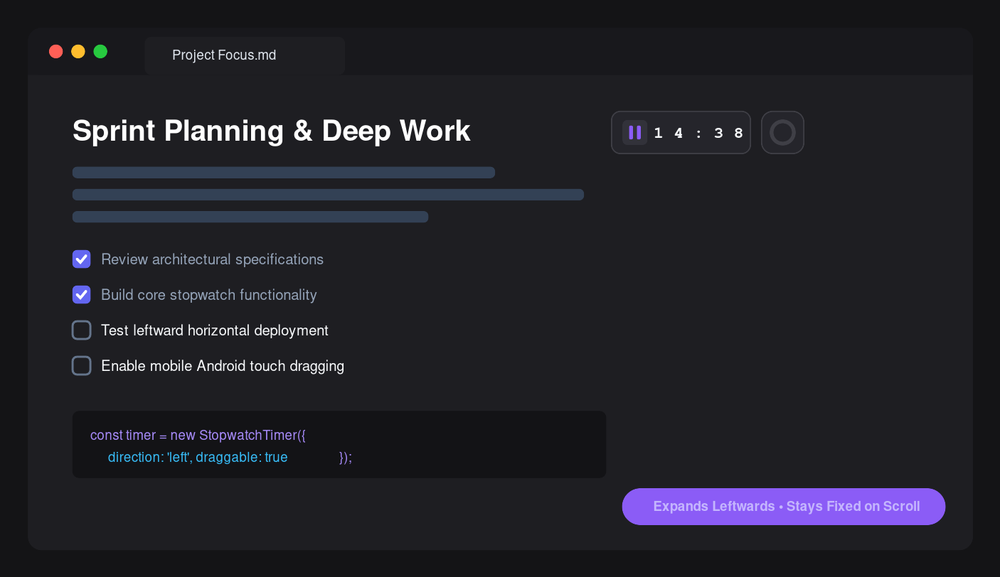
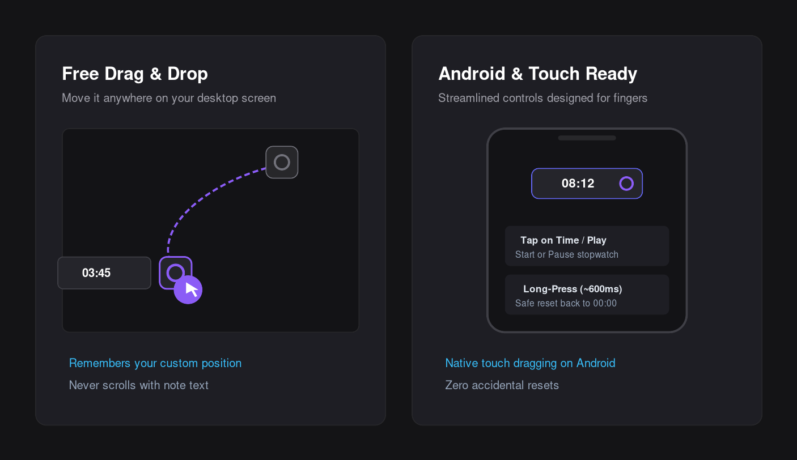

# Minichrono

**Minichrono** is a minimal, elegant stopwatch plugin for [Obsidian](https://obsidian.md). It floats seamlessly above your workspace, deploying horizontally to the left so it never obstructs your notes or scrolls away.



---

### Features

- **Horizontal Leftward Deployment:** Hovering over or tapping the timer icon smoothly expands the control panel to the left along the top toolbar, keeping your note view unobstructed.
- **Fixed & Free Draggable:** 
  - Stays fixed on screen regardless of note scrolling (`position: fixed`).
  - Drag and drop it anywhere on your screen. Remembers your preferred position across sessions.
- **Full Touch & Mobile Support (Android/iOS):** Native touch-drag support and gesture-friendly interactions.
- **Circular Second-Hand:** A clean SVG progress ring provides real-time visual feedback, completing a full circular rotation every 60 seconds.
- **Accurate Time Tracking:** Uses timestamp-based elapsed time calculations so it never drifts when Obsidian is in the background or minimized.
- **Streamlined, Accident-Free Controls:**
  - **Click/Tap time or Play button:** Start / Pause the stopwatch.
  - **Long-press (~600ms) or Right-click on time:** Reset back to `00:00`.
  - **Click/Tap icon:** Pin / unpin the control panel to keep it open while working.
- **Dynamic Formatting:** Automatically displays `MM:SS` and seamlessly switches to `HH:MM:SS` after reaching 60 minutes.
- **Command Palette Support:**
  - `Minichrono: Iniciar/pausar cronómetro`
  - `Minichrono: Reiniciar cronómetro`
  - `Minichrono: Restablecer posición del cronómetro`



---

### Installation

#### Official Community Directory (Recommended)
1. Open Obsidian **Settings** > **Community plugins**.
2. Turn off **Restricted mode**.
3. Click **Browse** and search for **Minichrono**.
4. Click **Install**, then **Enable**.

#### Manual Installation
1. Download `main.js`, `manifest.json`, and `styles.css` from the [latest release](https://github.com/jcreaweb/minichrono/releases).
2. Create a folder named `minichrono` in your Obsidian vault's plugin directory: `<vault>/.obsidian/plugins/minichrono`.
3. Copy `main.js`, `manifest.json`, and `styles.css` into that directory.
4. Reload Obsidian, then enable **Minichrono** in Settings.

---

### Development

```bash
# Install dependencies
npm install

# Build for production
npm run build

# Development with hot reload
npm run dev
```

---

### License

This project is licensed under the [MIT License](LICENSE).
